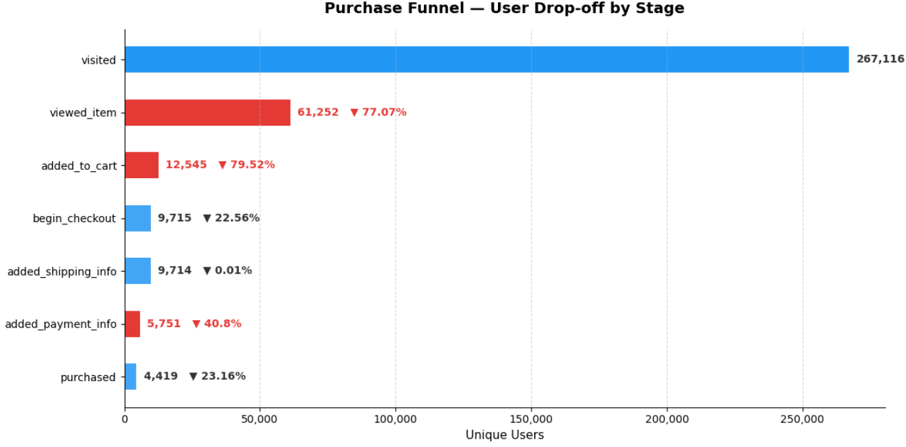
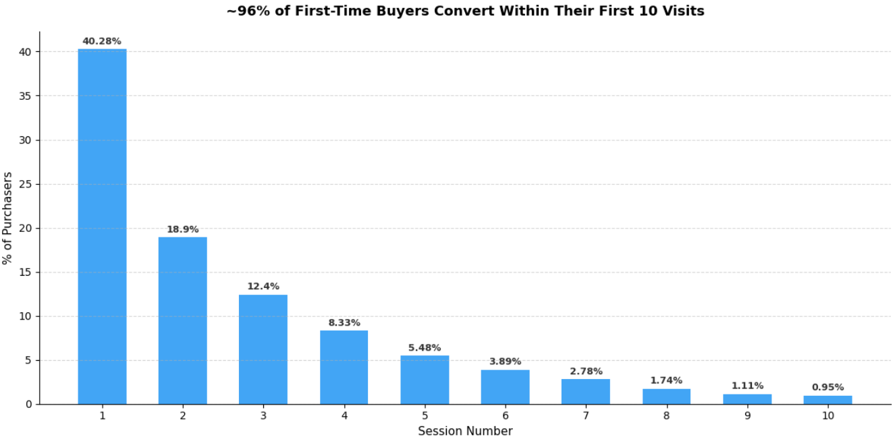
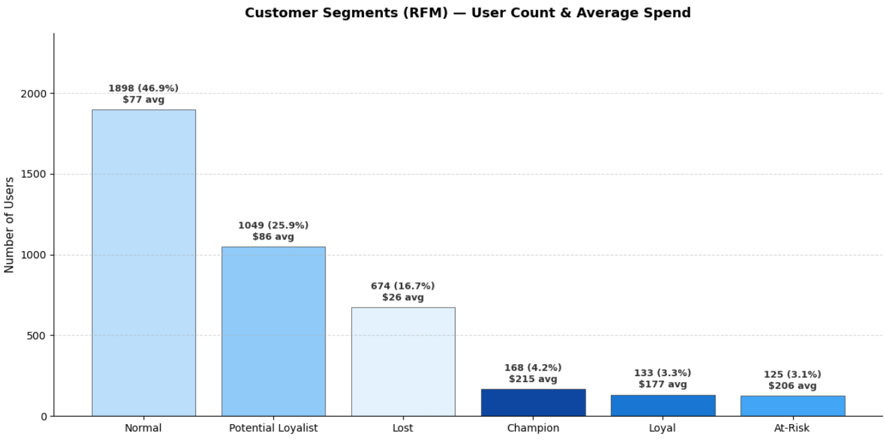

# Funnel Leaks: E-commerce Conversion Analysis (GA4)

## Overview

An exploratory product analytics project on Google's public GA4 obfuscated
sample e-commerce dataset (Google Merchandise Store), covering 92 days of
event data (Nov 2020 – Jan 2021).

The central questions are simple: how many visitors actually convert, and
where along the purchase journey does the rest of the traffic fall away?
It also asks whether that drop-off looks the same across all visitors or
differs depending on who they are — their device, traffic source, or
country. From there, the analysis extends into session behavior, customer
value segmentation, and intent signals like search and promotion
engagement.

## Dataset

- **Source:** `bigquery-public-data.ga4_obfuscated_sample_ecommerce`
- **Period:** Nov 1, 2020 – Jan 31, 2021 (92 days)
- **Scale:** ~4.3M events, ~270K users, 4,899 clean orders from 4,047 buyers
- **Note:** This is Google's obfuscated public sample data. Some fields
  (`user_id`, `search_term`, deep campaign attribution) are obfuscated or
  null by design. See [Limitations](#limitations) for how this shaped the
  analysis.

## Tools

- SQL (BigQuery) handles all querying — CTEs and views — and aggregation
- Python (Pandas, Matplotlib) handles reshaping and visualization

## Key Findings at a Glance

- Overall conversion is **1.65%**, with the biggest traffic loss (79.5%)
  happening at view_item → add_to_cart, and the sharpest checkout
  friction (**40.8%**) at the payment step
- Device and geography make almost no difference to conversion (top 10
  countries all fall between **1.49% and 1.93%**); traffic medium is the
  only segment with a visible spread, with referral at **1.89%** and CPC
  at **0.98%**
- **60% of buyers need more than one session** before purchasing, and
  purchasing sessions look different from the rest — median **10.85 vs
  0.13 engaged minutes** and **24 vs 2 page views**
- Both **search use and promotion clicks correlate with ~4.4x higher
  conversion** — strong intent signals, though not proven to be causal
- **Apparel drives 46.8% of revenue**; a small group of At-Risk customers
  (~$206 avg spend, ~69 days since last purchase) are nearly as valuable
  per customer as Champions (~$215) but going quiet
- Cohort/retention and RFM frequency results were **inconclusive given
  the 92-day window** — reported with that caveat rather than overstated

---

## 1. Funnel Analysis

To find out where exactly users drop off between landing on the site and
completing a purchase — and whether that drop-off looks different for
different kinds of users — unique users were traced through the full
purchase funnel: visit → view item → add to cart → begin checkout → add
shipping → add payment → purchase.

**Findings**
- Overall conversion rate is **1.65%** — 98.35% of visitors never purchase
- **79.5% drop-off** between viewing an item and adding it to cart — high
  browse, low intent traffic
- **40.8% drop-off at the payment step**, the sharpest drop within
  the checkout flow, despite users having already committed
  shipping information

**Segmented funnel**

| Segment | Finding |
|---|---|
| Device | Conversion and drop-off are nearly identical across desktop, mobile, and tablet — device is not a factor. Users who visited on more than one device are counted under each (about 1.5% of visitors) |
| Traffic medium | Referral converts best (1.89%), CPC worst (0.98%) despite being a paid channel. `<Other>` and `(data deleted)` values are grouped as Unassigned / Other (~24% of visitors). Users can appear under more than one medium (group totals exceed total visitors by about 20%), so channel rates are approximate |
| Geo (top 10 countries) | Conversion is consistent (1.49%–1.93%) across all top countries — drop-off is site-wide, not regional |

---

## 2. Session Analysis

To understand what separates a session that ends in purchase from one
that doesn't, and how many visits it typically takes before someone buys,
a session-level table (user + session ID, engagement time, pages visited,
engagement flag, purchase flag) was built from raw event data.

**Findings**
- Across 360K sessions, **11.06%** never reach an engaged state and only
  **1.35%** end in a purchase
- Purchasing sessions look different from non-purchasing ones — median
  **10.85 vs 0.13 engaged minutes** and **24 vs 2 page views**, partly
  due to the checkout flow itself
- **40%** of buyers convert on their very first visit; the remaining 60%
  need multiple sessions before purchasing, and over 95% have purchased
  by their 10th session

---

## 3. Cohort & Retention Analysis

To check whether users come back after their first visit, and whether
buyers come back to buy again, weekly cohorts were built based on each
user's first activity (users with a `first_visit` event), with return
behavior tracked week-over-week — both for all visitors and for the
purchaser subset (repeat purchase, cohorted by first purchase week). The
last two weekly cohorts (Jan 24 and Jan 31) lack a complete follow-up
week and are excluded.

**Findings**
- Week 1 retention is **4.2%–5.4%** for November cohorts and dips to
  **2.4%–4.0%** in December–January, falling below 1% across all cohorts
  by Week 6
- Repeat purchase rate among buyers (return to purchase again) is
  roughly **0.8%-3.6%** in the week following their first purchase,
  also varying by cohort

**Limitation:** 92 days is insufficient for meaningful cohort/retention
analysis on a low-frequency merchandise store, where customers aren't
expected to buy weekly. A 12-month window would be needed to properly
evaluate retention, repeat purchase behavior, and acquisition trends. The
low numbers above reflect this constraint rather than a business problem.

---

## 4. Product & Revenue Analysis

To see what's actually driving revenue — which products and categories —
and identify the customers worth paying the most attention to, a
`clean_purchases` view was built to handle data quality issues found
during EDA: 450 purchase rows (~8%) with zero revenue and null quantity,
23 rows with no transaction ID, and duplicate transaction IDs (311 IDs
repeated by the same user, 15 shared across different users). The view
drops missing IDs and zero-revenue rows and deduplicates on transaction
ID + user.

**Overall metrics:** 4,899 clean orders, 4,047 unique buyers, total
revenue **$339,319**, average order value **$69.26**

*Revenue and RFM use `clean_purchases` (4,047 buyers); the funnel, cohort,
session, search, and promotion sections count all 4,419 users with a
purchase event.*

**Findings**
- The top 5 products by revenue are all apparel (hoodies, sweatshirts,
  joggers, pullover, fleece)
- **Apparel drives 46.8% of total revenue** and dominates units sold —
  it is the core product line of this store

### RFM Segmentation

Segmented buyers using Recency, Frequency, and Monetary scores (recency
and monetary on quintiles, frequency as 1 / 2 / 3+ transactions) into
Champion, Loyal, Potential Loyalist, Normal, At-Risk, and Lost.

**Findings**
- **Normal buyers (46.9% of users)** drive 43% of revenue ($146K), and
  **Potential Loyalists (25.9%)** drive 26.6% ($90K)
- **168 Champions (4.2%, ~$215 avg spend)** generate 10.6% of revenue
  ($36.1K). **125 At-Risk customers (3.1%, ~$206 avg spend, ~69 days
  since last purchase)** are nearly as valuable per customer but have
  gone quiet
- **Limitation:** with only 92 days of data, these labels reflect a
  snapshot. Frequency scores especially would likely shift with a longer
  observation window, since most buyers (avg ~1 transaction in the three
  largest segments) haven't had time to establish a repeat-purchase
  pattern

---

## 5. Search Behavior

To check whether using the site's search function signals that someone
is more likely to buy — `search_term` values are obfuscated
(`<obfuscated>`) so query content couldn't be analyzed, so instead
conversion rates were compared between users who did and didn't trigger
`view_search_results`.

**Findings**
- Users who searched convert at **6.1%** vs. **1.4%** for non-searchers —
  **4.4x higher**. Search activity is among the strongest purchase-intent
  signals found in this dataset

---

## 6. Promotion Analysis

To check whether users who engage with on-site promotions convert at a
higher rate, conversion rates were compared between users who clicked a
promotion (`select_promotion`) and those who didn't.

**Findings**
- Users who clicked a promotion convert at **6.5%** vs. **1.5%** for
  non-clickers — **4.4x higher**, though this may reflect that high-intent
  users are simply more likely to interact with promotions, rather than
  promotions causing the conversion

---

## Limitations

- **92-day window:** too short for reliable cohort, retention, and
  repeat-purchase analysis, and for RFM frequency scoring to mature
- **Obfuscated fields:** `user_id` is null for nearly all rows (no
  logged-in/cross-device analysis), `search_term` is fully obfuscated,
  and some `traffic_source` attribution is unreliable — about 24% of
  visitors have an `<Other>` or `(data deleted)` medium
- **Segment overlap:** users can appear in more than one device group
  (~1.5% of visitors) and more than one medium group (~20%), so segment
  totals exceed total visitors
- **Data quality:** raw purchase events contained duplicate
  `transaction_id`s, missing IDs, and zero-revenue rows — handled via a
  dedicated `clean_purchases` view used for all revenue and RFM analysis
- **Two buyer counts:** 4,419 users with a purchase event (funnel and
  behavior sections) vs. 4,047 buyers after cleaning (revenue and RFM)
- All findings are based on Google's obfuscated public sample data, which
  Google itself notes has "somewhat limited internal consistency" — numbers
  should be read as directional patterns, not exact business metrics

---

## Notebook

The full analysis, including all SQL queries, intermediate outputs, and
visualizations, is in
[`ga4-ecommerce-funnel-analysis.ipynb`](ga4-ecommerce-funnel-analysis.ipynb).
